# Figures of the project, made by script from its own data

Every figure here is drawn by `python/project_figures.py` from committed data: files already in the
tree, or a small extract (`docs/figures/`) that records the commit it was read at, the SHA-256 of
what it was made from and the command that remakes it. Beside each figure is a sidecar
(`docs/img/figures/<name>.json`) holding every number drawn, the digest of every source and the
cross-checks that were run. **This page is written by the same script**, so a number in a caption is
the number in the figure.

`python python/project_figures.py --check`, which is the `generated` stage's seventh generator in
`verify/run.sh`, remakes everything in memory and fails by name on a figure, sidecar or caption that
differs from a fresh generation, on an extract whose digests no longer hold, on a number or sentence
that the README or another document states and a figure disagrees with, on an SVG outside what
GitHub keeps or with a text clipped by its canvas or a mark drawn over its own source line, and on a
ledger entry that states a kernel slack which the timing figure neither draws nor lists. It reads no
git history, no network and no card, and then plants each of those faults in a scratch copy to show
that it would catch it.

Each figure is a `<picture>`, so GitHub shows the reader's theme. The rules are
`python/readme_charts.py`'s: literal geometry and colour only, no fonts, scripts or CSS variables.
The README's own two charts (`docs/img/bench/`) are not repeated here.

| figure | what it answers |
|---|---|
| [history-commits](#history-commits) | What was worked on, day by day |
| [history-size](#history-size) | What the repository is made of, and the record it keeps |
| [verify-growth](#verify-growth) | How the gate grew |
| [verify-stages](#verify-stages) | The runner's stages, and which budget runs each |
| [formats](#formats) | One 256-bit beat, and the four formats it carries |
| [hw-area](#hw-area) | Where a tile's area goes, and what the U50 could carry |
| [hw-clock](#hw-clock) | How far the clock was pushed, and what it left in slack |
| [perf-speedup](#perf-speedup) | Where the card wins, for every operation |
| [perf-lanes](#perf-lanes) | The tile is beat-limited: throughput follows the lanes in a beat |
| [perf-crossings](#perf-crossings) | How many elements a call needs before the card pays |
| [math-cost](#math-cost) | What a correctly rounded function costs the tile |
| [math-marks](#math-marks) | How often a correctly rounded routine has to say 'undecided' |
| [stress-timeline](#stress-timeline) | The card's long run: what ran, and what passed |
| [stress-telemetry](#stress-telemetry) | What the card drew and how warm it ran |
| [stress-sweep](#stress-sweep) | What the sweep covered, and what of it ran on the tile |

## History

### What was worked on, day by day

<picture>
  <source media="(prefers-color-scheme: dark)" srcset="img/figures/history-commits-dark.svg">
  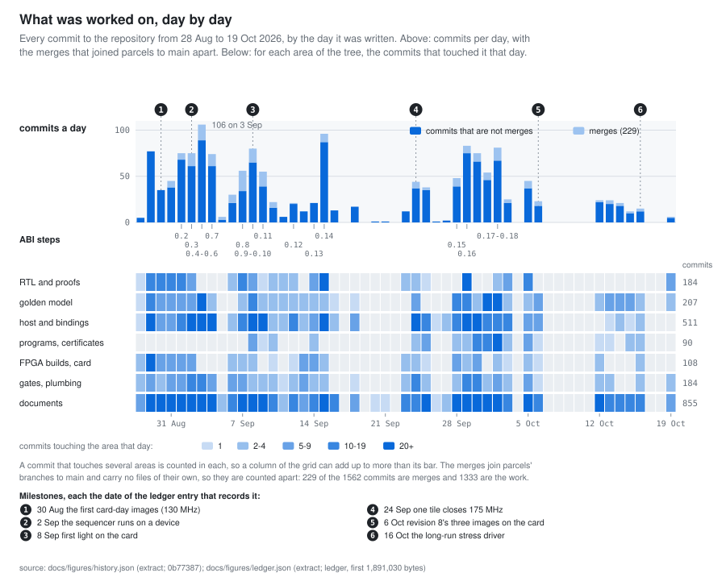
</picture>

**Shows.** 1,562 commits in 53 days, 229 of them merges; the busiest day was 3 Sep, with 106. Each
area's busiest week, by commits touching it: FPGA builds, card the week of 24 Aug (32); gates,
plumbing the week of 31 Aug (54); host and bindings the week of 31 Aug (154); RTL and proofs the
week of 31 Aug (39); documents the week of 28 Sep (216); golden model the week of 28 Sep (78);
programs, certificates the week of 28 Sep (55). The ABI steps, 0.2 to 0.18, are on the days
docs/COMPATIBILITY.md dates them.

**Does not show.** How big the commits were, or who wrote what: a commit counts once whatever it
changed. A day is the author's local day (every commit is dated at UTC-7), not UTC's. History is
read at 0b77387 and ends there; commits made after it are in the next remake.

**Source.** `docs/figures/history.json` (0b77387), `docs/figures/ledger.json` (ledger, first
1,891,030 bytes). Remade by `python python/project_figures.py --only history-commits --write`; the
numbers and digests are in `docs/img/figures/history-commits.json`.

**Held to the record.** 2 statements are checked against this figure on every run, 2 agree:
`docs/COMPATIBILITY.md` (1), `docs/figures/history.json` (1).

### What the repository is made of, and the record it keeps

<picture>
  <source media="(prefers-color-scheme: dark)" srcset="img/figures/history-size-dark.svg">
  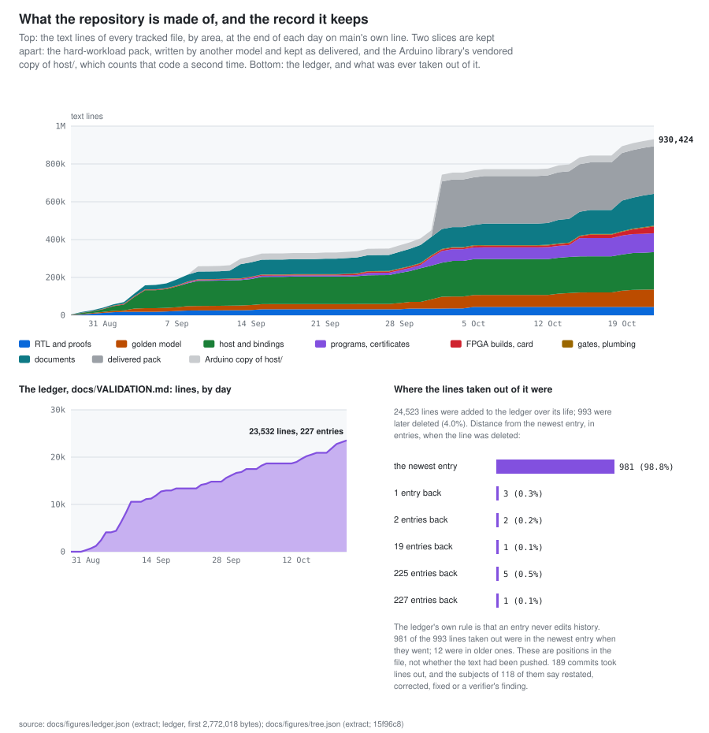
</picture>

**Shows.** 844,665 text lines in 1,251 tracked text files at 0b77387: the largest slice is the
hard-workload pack (251,757 lines, written by another model and kept as delivered), then host
library and bindings (190,879), documents (127,058), programs and certificates (96,615) and golden
model and compiler (76,476). The Arduino library's vendored copy of host/'s sources adds 36,060
lines, a second copy. Beside it, the ledger (21,037 lines in 192 entries) and a measurement of its
rule that it is append-only: 518 of the 21,561 lines ever added to it were later deleted, 515 of
those in the newest entry at the time.

**Does not show.** Lines of working code: data files, captured outputs and compiled programs are
lines too, and a line is a line however long. Nor the ledger's content: it counts lines, not whether
a sentence that was changed in place mattered.

**Source.** `docs/figures/ledger.json` (ledger, first 1,891,030 bytes), `docs/figures/tree.json`
(0b77387). Remade by `python python/project_figures.py --only history-size --write`; the numbers and
digests are in `docs/img/figures/history-size.json`.

**Held to the record.** 5 statements are checked against this figure on every run, 5 agree:
`bindings/arduino/sync.py` (1), `docs/VALIDATION.md` (1), `docs/figures/tree.json` (1),
`programs/workloads/README.md` (2).

**Data and prose.** docs/VALIDATION.md says it is append-only and that "an entry never edits
history". Git says 518 of the 21,561 lines ever added to it were later deleted, by 82 commits (54 of
whose subjects say restated, corrected, fixed or a verifier's finding: a count of those words, not a
reading of each): 515 (99.4%) from the newest entry at the time and 3 from older entries (1 line 19
entries back, in d9b5ac4 on 4 Sep; 1 line 1 entry back, in e3fe2ca on 6 Oct; 1 line 1 entry back, in
3947c44 on 6 Oct). These are positions in the file: whether the text had been pushed when it was
edited is not in the repository's history, so it is not counted here. This is reported as measured,
and nothing here corrects it.

## Verification

### How the gate grew

<picture>
  <source media="(prefers-color-scheme: dark)" srcset="img/figures/verify-growth-dark.svg">
  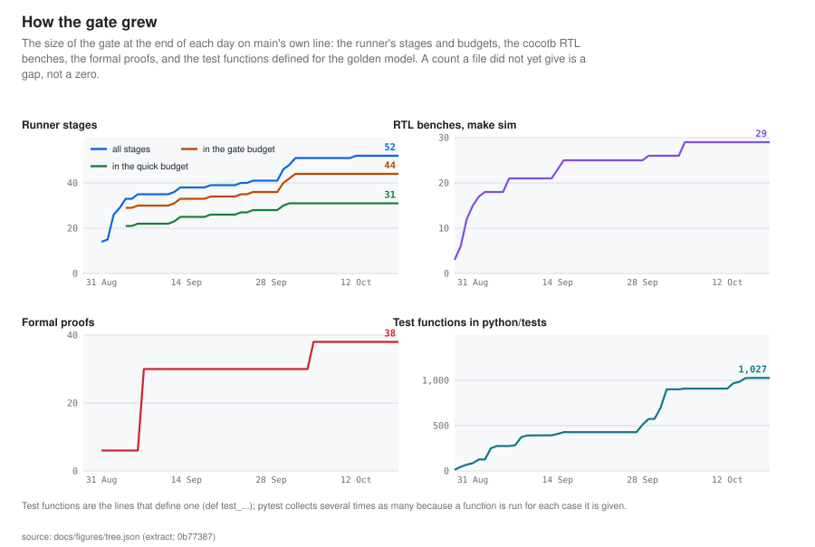
</picture>

**Shows.** How much the project asks of itself before it believes a change: at 0b77387 the runner
has 52 stages (31 in the quick budget, 44 in the gate budget), 29 RTL benches run under `make sim`,
38 formal proofs run, and python/tests defines 1,027 test functions. On the first day each was
counted there were 14 stages, 3 benches, 6 proofs and 13 test functions.

**Does not show.** How long any of it takes, or whether it passes: these are sizes, counted from the
files at each day's last commit on main (the runner's stage lines and its two budget lists;
tb/Makefile's bench list in each of the three forms it has had; formal/run.sh's run_proof lines; the
def test_ lines). The figure ends at 0b77387; `--check` prints a note, and does not fail, when the
tree has moved on.

**Source.** `docs/figures/tree.json` (0b77387). Remade by `python python/project_figures.py --only
verify-growth --write`; the numbers and digests are in `docs/img/figures/verify-growth.json`.

### The runner's stages, and which budget runs each

<picture>
  <source media="(prefers-color-scheme: dark)" srcset="img/figures/verify-stages-dark.svg">
  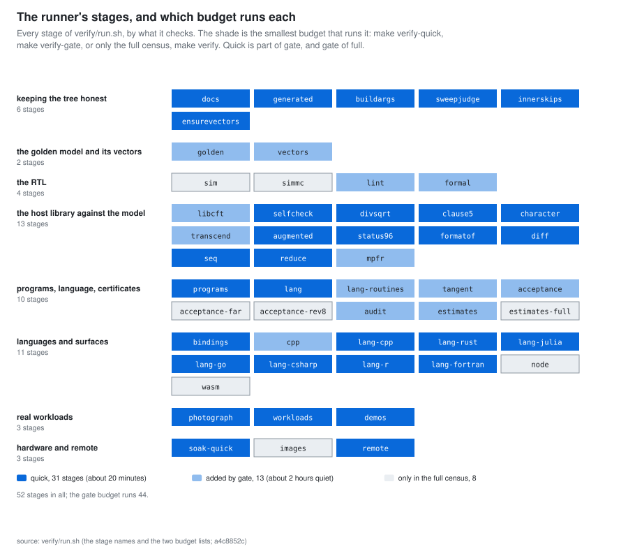
</picture>

**Shows.** What the gate is made of: 52 stages in 8 groups, 31 in the quick budget, 13 more in the
gate budget and 8 only in the full census (sim, simmc, acceptance-far, acceptance-rev8,
estimates-full, node, wasm, images).

**Does not show.** What each stage proves or how long it takes: docs/VERIFICATION.md is the map of
that. The grouping is this script's (python/project_figures.py), not the runner's: a stage it does
not place is drawn in a group of its own, named, so a new stage shows up instead of vanishing.

**Source.** `verify/run.sh` (the stage names and the two budget lists). Remade by `python
python/project_figures.py --only verify-stages --write`; the numbers and digests are in
`docs/img/figures/verify-stages.json`.

**Held to the record.** 5 statements are checked against this figure on every run, 5 agree:
`CLAUDE.md` (3), `README.md` (2).

## Hardware

### One 256-bit beat, and the four formats it carries

<picture>
  <source media="(prefers-color-scheme: dark)" srcset="img/figures/formats-dark.svg">
  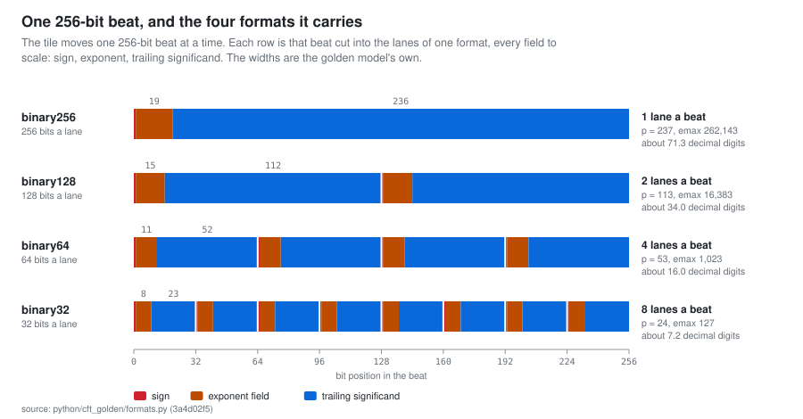
</picture>

**Shows.** The four interchange formats the tile computes, drawn to scale across the 256-bit beat it
moves at a time: one binary256 lane, two binary128, four binary64 or eight binary32, so fifteen FMA
cores in four banks. Field widths, precision and the largest exponent are the golden model's.

**Does not show.** How the lanes are built (the banks are separate pipes, not one lane split four
ways) or what they cost; hw-area has the areas.

**Source.** `python/cft_golden/formats.py`. Remade by `python python/project_figures.py --only
formats --write`; the numbers and digests are in `docs/img/figures/formats.json`.

**Held to the record.** 21 statements are checked against this figure on every run, 21 agree:
`README.md` (1), `docs/DETERMINISM.md` (20).

### Where a tile's area goes, and what the U50 could carry

<picture>
  <source media="(prefers-color-scheme: dark)" srcset="img/figures/hw-area-dark.svg">
  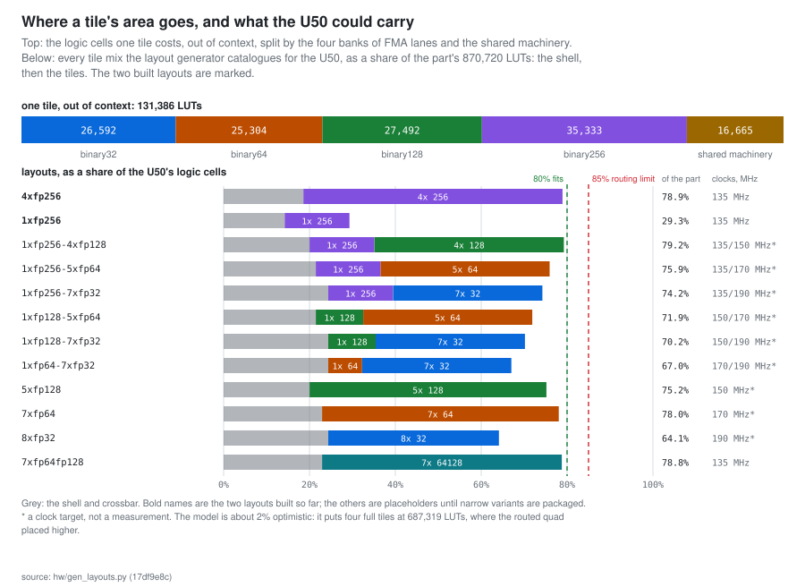
</picture>

**Shows.** A full tile costs 131,386 LUTs out of context: the four banks cost 26,592, 25,304, 27,492
and 35,333 (binary32 to binary256, each about the same because lanes halve as precision doubles,
until binary256 cannot halve) and the shared machinery 16,665. Four of them and the shell come to
78.9% of the U50 in the model; narrower tiles let more fit.

**Does not show.** Placed results: this is hw/gen_layouts.py's model, from tile costs measured out
of context, and it is about 2% optimistic against the routed quad (docs/LAYOUTS.md). Only the two
layouts marked bold have been built.

**Source.** `hw/gen_layouts.py`. Remade by `python python/project_figures.py --only hw-area
--write`; the numbers and digests are in `docs/img/figures/hw-area.json`.

**Held to the record.** 1 statement is checked against this figure on every run, 1 agree:
`docs/LAYOUTS.md` (1).

### How far the clock was pushed, and what it left in slack

<picture>
  <source media="(prefers-color-scheme: dark)" srcset="img/figures/hw-clock-dark.svg">
  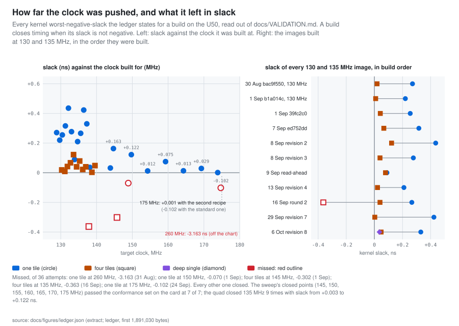
</picture>

**Shows.** 43 U50 builds the ledger states a kernel slack for, 5 of them missed. One tile closed 175
MHz (by +0.001 ns, with the second recipe) and passed on the card. Four tiles closed 135 MHz 10
times from 1 Sep, with slack from +0.003 to +0.143 ns, and missed it once with a kernel slack stated
(round 2 quad, first try, -0.363; closed on a rebuild); at 145 they missed by -0.302. The long-shot
build for 260 MHz missed by -3.163 ns and is off the chart.

**Does not show.** Misses for which the ledger states only the whole design's slack and not the
kernel's: one tile at 135 MHz, 1 Sep, -0.577 ns; four tiles at 135 MHz, 2 Sep, -0.141 ns; four tiles
at 135 MHz, 2 Sep, -0.113 ns. They are not drawn, and neither are the ledger's out-of-context
probes. What is drawn is every U50 build for which the ledger states a kernel slack, and the check
holds that: it scans the ledger's pinned prefix on every run, and 21 of the 31 entries that state a
kernel slack are drawn and the other 10 are listed with why (repeats of a drawn number, a citation,
probes); likewise the 11 that state a negative WNS (6 drawn, 5 left out). The scan finds what its
patterns can see, which the sidecar gives. A small positive slack is not a margin to build on: the
ledger's own lesson (2026-09-01, line 340) is that an achieved-period reading from a hopelessly
over-constrained run understates what the router does for an achievable target.

**Source.** `docs/figures/ledger.json` (ledger, first 1,891,030 bytes). Remade by `python
python/project_figures.py --only hw-clock --write`; the numbers and digests are in
`docs/img/figures/hw-clock.json`.

**Held to the record.** 3 statements are checked against this figure on every run, 3 agree:
`README.md` (1), `docs/figures/ledger.json` (2).

## Performance

### Where the card wins, for every operation

<picture>
  <source media="(prefers-color-scheme: dark)" srcset="img/figures/perf-speedup-dark.svg">
  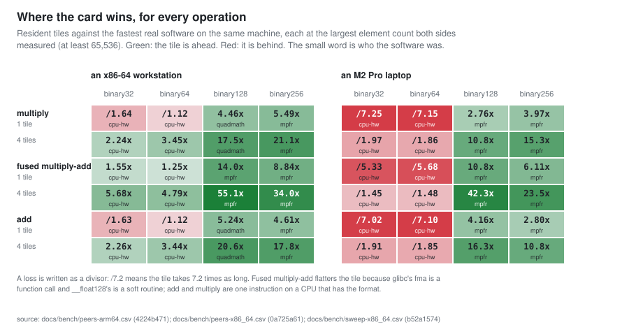
</picture>

**Shows.** The README's multiply chart for every operation the sweep and the peer runs share
(multiply, fused multiply-add, add): 48 cells, the tile ahead in 32 and behind in 16. The extremes
are 55.1x ahead and 7.2x behind.

**Does not show.** Divide and square root (the peer runs measure them, the device sweep does not),
the non-arithmetic operations, or anything at a size below 65,536 elements, where a device call is
mostly fixed cost; the README's cost-by-size chart has that.

**Source.** `docs/bench/peers-arm64.csv`, `docs/bench/peers-x86_64.csv`,
`docs/bench/sweep-x86_64.csv`. Remade by `python python/project_figures.py --only perf-speedup
--write`; the numbers and digests are in `docs/img/figures/perf-speedup.json`.

**Held to the record.** 15 statements are checked against this figure on every run, 15 agree:
`README.md` (15).

### The tile is beat-limited: throughput follows the lanes in a beat

<picture>
  <source media="(prefers-color-scheme: dark)" srcset="img/figures/perf-lanes-dark.svg">
  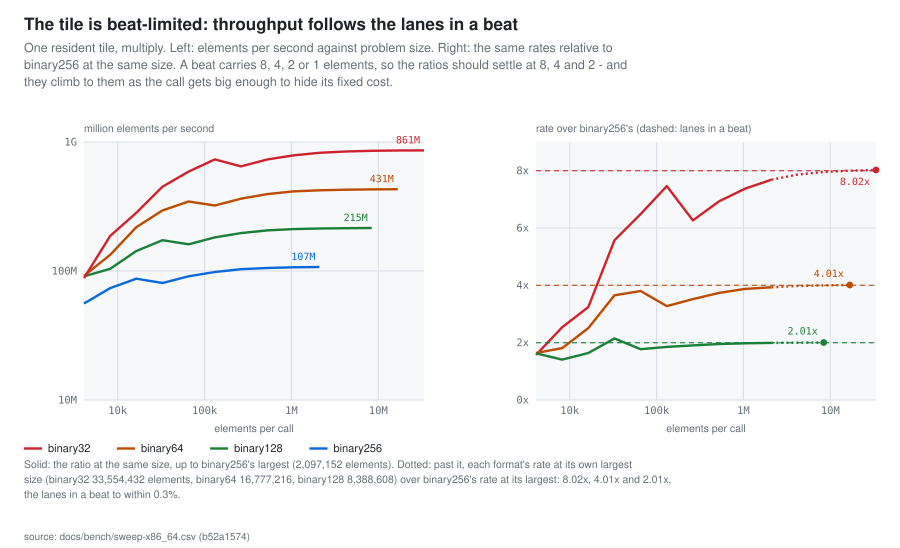
</picture>

**Shows.** That the tile's rate is set by the beat. At a million elements one tile moves 788, 414,
211 and 107 million binary32, 64, 128 and 256 elements a second, which is 7.4x, 3.9x and 2.0x
binary256's rate against the 8, 4 and 2 the lane counts say; the ratios settle on those numbers at
the largest sizes (8.02, 4.01, 2.01).

**Does not show.** A different operation (add and fused multiply-add are within 0.05% of multiply's
rate at each format's largest size), the PCIe path, or four tiles: this is the resident path of one
tile. The ratios at the top rest on binary256 having been measured only up to 2,097,152 elements.

**Source.** `docs/bench/sweep-x86_64.csv`. Remade by `python python/project_figures.py --only
perf-lanes --write`; the numbers and digests are in `docs/img/figures/perf-lanes.json`.

**Held to the record.** 5 statements are checked against this figure on every run, 5 agree:
`README.md` (5).

### How many elements a call needs before the card pays

<picture>
  <source media="(prefers-color-scheme: dark)" srcset="img/figures/perf-crossings-dark.svg">
  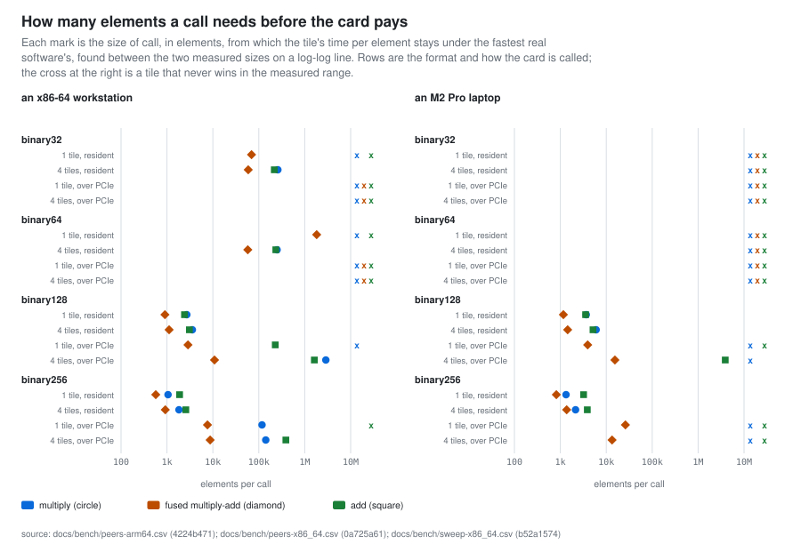
</picture>

**Shows.** How big a call has to be. On the workstation one resident tile passes the best software
at 1,056 elements for binary256 multiply and 2,703 for binary128; staged over PCIe it needs far more
or never gets there, because the bus costs about 4.7x resident at a million elements (median of the
four formats). 49 of the 96 cells never cross in the measured range.

**Does not show.** The size at which any call breaks even in practice: the sizes are interpolated
between measured points on two machines, with the baseline the fastest real software at each size,
never the library's own softfloat; and a crossing near the smallest measured size is a floor.

**Source.** `docs/bench/peers-arm64.csv`, `docs/bench/peers-x86_64.csv`,
`docs/bench/sweep-x86_64.csv`. Remade by `python python/project_figures.py --only perf-crossings
--write`; the numbers and digests are in `docs/img/figures/perf-crossings.json`.

**Held to the record.** 3 statements are checked against this figure on every run, 3 agree:
`README.md` (3).

## The math library

### What a correctly rounded function costs the tile

<picture>
  <source media="(prefers-color-scheme: dark)" srcset="img/figures/math-cost-dark.svg">
  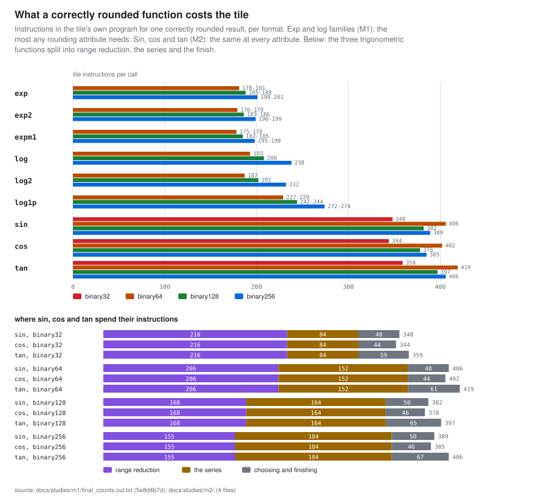
</picture>

**Shows.** Each correctly rounded routine is a program of 178 to 419 tile instructions at its
format: exp and expm1 about 181, the log family 187 to 274, sin 348, 406, 382 and 389 (binary32 to
binary256). Binary256 costs 96% to 124% of what the same routine costs at binary64. Of sin, cos and
tan, range reduction takes 155 to 216 instructions.

**Does not show.** Time: an instruction is a pass of the sequencer over the lanes, not a clock
cycle, and the M1 and M2 numbers are counts of the compiled routines (the study's own scripts,
captured in docs/studies/m1/ and m2/), not measurements on the card. M1's exp and log family has no
binary32 row.

**Source.** `docs/studies/m1/final_counts.out.txt`, `docs/studies/m2/costs.fp128.out.txt`,
`docs/studies/m2/costs.fp256.out.txt`, `docs/studies/m2/costs.fp32.out.txt`,
`docs/studies/m2/costs.fp64.out.txt`. Remade by `python python/project_figures.py --only math-cost
--write`; the numbers and digests are in `docs/img/figures/math-cost.json`.

**Held to the record.** 6 statements are checked against this figure on every run, 6 agree:
`docs/studies/M2-trig.md` (5), `docs/studies/m2/costs.*.out.txt` (1).

### How often a correctly rounded routine has to say 'undecided'

<picture>
  <source media="(prefers-color-scheme: dark)" srcset="img/figures/math-marks-dark.svg">
  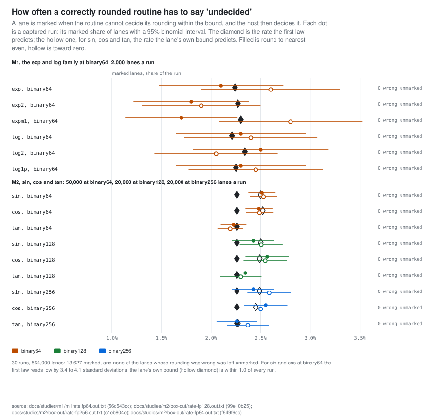
</picture>

**Shows.** How often the exp, log, sin, cos and tan routines mark a lane undecided: 564,000 lanes in
30 captured runs, 13,627 marked (2.42%), and in every run every marked lane's guessed rounding was
right and no wrong lane was unmarked. At binary64 the first law reads low for sin and cos by 3.4 to
4.1 standard deviations; the study's second, per-lane law is within 1.0 of every run.

**Does not show.** That the routines are correctly rounded: the marked lanes are decided by the
host, and the proof of the bound is docs/studies/M1-exp-log.md and M2-trig.md. These runs only count
how often the tile does not decide, and that it never decided wrongly in the lanes sampled. The 95%
intervals are binomial, from the lane count alone.

**Source.** `docs/studies/m1/m1rate.fp64.out.txt`, `docs/studies/m2/box-out/rate-fp128.out.txt`,
`docs/studies/m2/box-out/rate-fp256.out.txt`, `docs/studies/m2/box-out/rate-fp64.out.txt`. Remade by
`python python/project_figures.py --only math-marks --write`; the numbers and digests are in
`docs/img/figures/math-marks.json`.

**Held to the record.** 2 statements are checked against this figure on every run, 2 agree:
`docs/studies/M2-trig.md` (1), `docs/studies/m2/box-out/rate-*.out.txt` (1).

## Reliability

### The card's long run: what ran, and what passed

<picture>
  <source media="(prefers-color-scheme: dark)" srcset="img/figures/stress-timeline-dark.svg">
  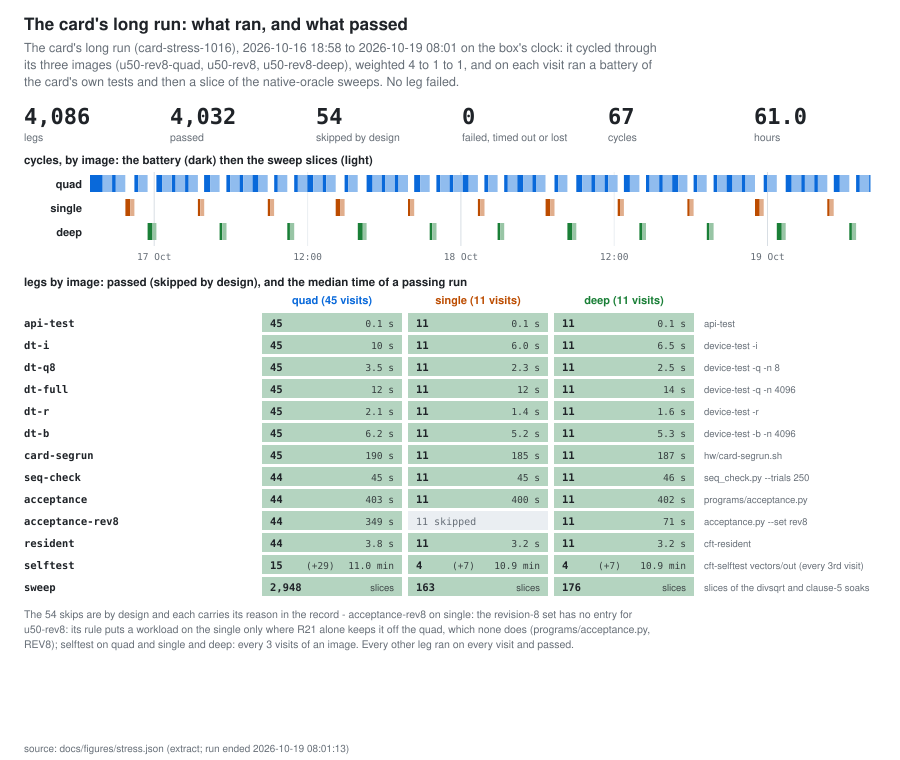
</picture>

**Shows.** The card's long run, card-stress-1016: 4,086 legs in 67 cycles over 61.0 hours, 4,032
passed, 54 skipped by design, and none failed, timed out, lost the device or failed to parse. It
visited the quad 45 times, the single 11 and the deep single 11, against weights of 4, 1 and 1. It
ended at 2026-10-19 08:01 on the box's clock; the reason it recorded is deadline, and the last visit
(the quad's 45th, cycle 67) was cut by the deadline after 7 of the battery's 12 legs, so seq-check,
acceptance, acceptance-rev8, resident and selftest show one pass fewer on the quad and it ran no
sweep slice.

**Does not show.** How hard the card was driven: the legs are short tests and soak slices, and 69%
of the sweep's cases ran in host code, where the tile does no work (see stress-sweep). Nor that the
same card would last longer. The times are the box's own clock; the run's commit and the images'
digests are in the sidecar.

**Source.** `docs/figures/stress.json` (run ended 2026-10-19 08:01:13). Remade by `python
python/project_figures.py --only stress-timeline --write`; the numbers and digests are in
`docs/img/figures/stress-timeline.json`.

**Held to the record.** 4 statements are checked against this figure on every run, 4 agree:
`docs/CARDDAY.md` (2), `docs/figures/stress.json` (2).

### What the card drew and how warm it ran

<picture>
  <source media="(prefers-color-scheme: dark)" srcset="img/figures/stress-telemetry-dark.svg">
  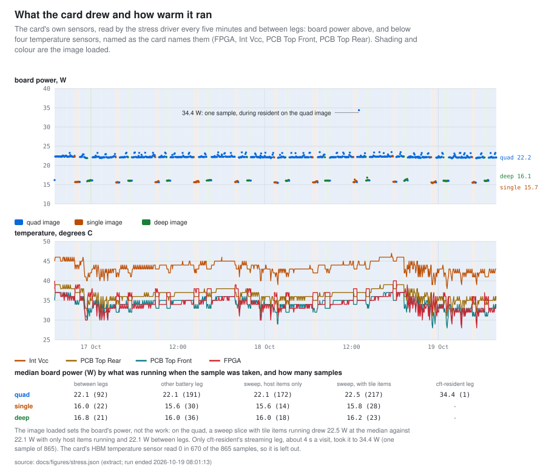
</picture>

**Shows.** 865 sensor samples over 61.0 hours. Board power sits at 22.2 W (median) with the quad
image loaded, 15.7 W with the single and 16.1 W with the deep one; on the quad it was 22.5 W with
tile items running and 22.1 with only host items. The highest sample, 34.4 W, is the one taken
during cft-resident's streaming leg. The four temperatures stay between 28 and 47 degrees C.

**Does not show.** Power at full rate: the README's "about 35 watts" is four tiles streaming, which
this run sampled once, in a leg of about 4 s; the sweep slices' tile work drew 22.5 W. Nor the
card's HBM temperature (the sensor reads 0 in 670 of 865 samples).

**Source.** `docs/figures/stress.json` (run ended 2026-10-19 08:01:13). Remade by `python
python/project_figures.py --only stress-telemetry --write`; the numbers and digests are in
`docs/img/figures/stress-telemetry.json`.

**Held to the record.** 5 statements are checked against this figure on every run, 5 agree:
`README.md` (3), `docs/BENCHMARKS.md` (2).

### What the sweep covered, and what of it ran on the tile

<picture>
  <source media="(prefers-color-scheme: dark)" srcset="img/figures/stress-sweep-dark.svg">
  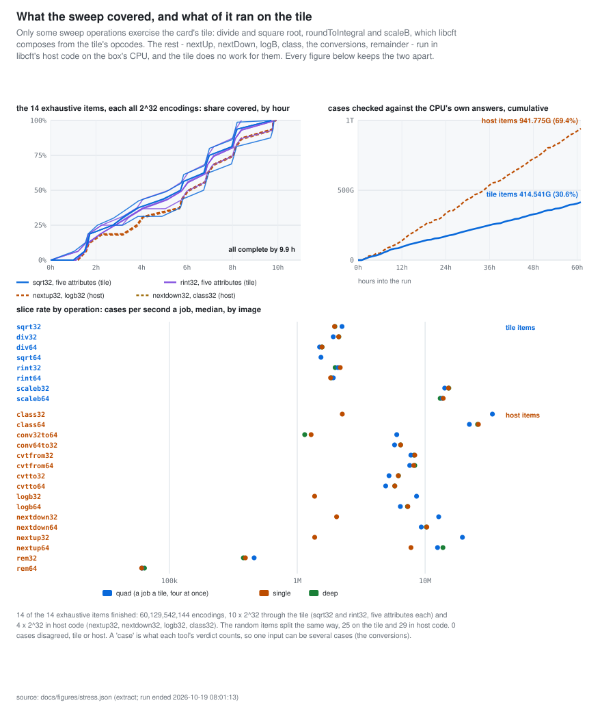
</picture>

**Shows.** The stress run's sweep: 1,356,316,228,303 cases in all, 414,541,012,992 (30.6%) from
items that exercise the tile (divide, square root, roundToIntegral, scaleB: 42,949,672,960
exhaustive and 371,591,340,032 random) and 941,775,215,311 from items that run in libcft's host code
on the box's CPU. All 14 exhaustive items covered every one of their 2^32 encodings, 10 through the
tile and 4 in host code; 0 cases disagreed with the oracle.

**Does not show.** A total of cases "on the card". The sweep's total is the sum of two kinds of item
and only the tile items exercise the card, so the figure gives both numbers and never calls the sum
"on the card". The host items test libcft's host code against the CPU's own answers, and the tile
does no work for them. The split is read from host/src/clause5.c and host/tools/divsqrt_soak.c on
every check.

**Source.** `docs/figures/stress.json` (run ended 2026-10-19 08:01:13). Remade by `python
python/project_figures.py --only stress-sweep --write`; the numbers and digests are in
`docs/img/figures/stress-sweep.json`.

**Held to the record.** 6 statements are checked against this figure on every run, 6 agree:
`README.md` (1), `host/src/clause5.c` (4), `host/tools/divsqrt_soak.c` (1).

## Where the extracts come from

| extract | what it is | read at | remake |
|---|---|---|---|
| `docs/figures/history.json` | commits per day and the areas each touched, the merges apart, and the ABI steps' dates | 0b77387 | `python python/figure_extracts.py history --as-of 0b77387ea1266f4d4a5e30c8798f57e8b6dc6ef8` |
| `docs/figures/ledger.json` | the U50 builds the ledger states a kernel slack for (kernel WNS by image, tiles and clock), what else it states a slack for and why that is not drawn, and the ledger's milestones, read out of docs/VALIDATION.md by patterns that name the entry | ledger, first 1,891,030 bytes | `python python/figure_extracts.py ledger` |
| `docs/figures/stress.json` | the card's long stress run (card-stress-1016), reduced from its metrics.jsonl: the legs, the cycles, the telemetry, and the sweep with its tile items and host items apart | run ended 2026-10-19 08:01:13 | `python python/figure_extracts.py stress PATH/metrics.jsonl --report PATH/report.txt` |
| `docs/figures/tree.json` | the tree at the end of each day on main's own line: text lines by area, the ledger's size and line traffic, and the size of the gate | 0b77387 | `python python/figure_extracts.py tree --as-of 0b77387ea1266f4d4a5e30c8798f57e8b6dc6ef8` |

## What the check does and does not do

- A figure of the current state (the benchmark sweeps, the layout generator, the formats, the
  design studies' captured runs, the runner's stage names and budget lists) is read from the tree
  every time, so it fails the check the moment what it reads moves.

- A figure of history reads an extract pinned to a commit and says so on its face; it lags the
  project until someone with the full history remakes it (`python python/figure_extracts.py
  history`, `tree`, `ledger`), and `--check` prints a note, and does not fail, when the gate's own
  files have moved past it.

- `python python/figure_extracts.py --verify` remakes every extract from its source and compares
  the bytes: it needs the full git history, and for the stress run the raw `metrics.jsonl`, which
  is 8 MB and is never committed.

- A number the record states in words is held to the figure by a pattern; reword the sentence and
  the check says that the statement is gone, by name, rather than passing.
